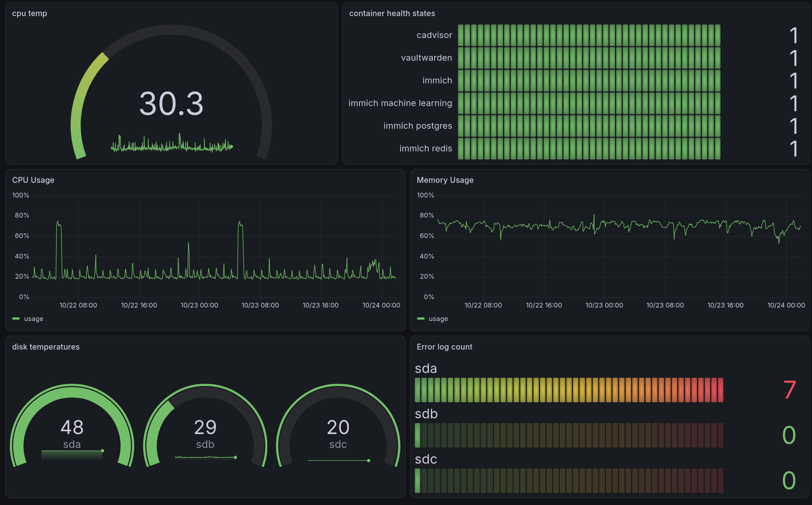

# csa-monitoring-stack
A containerized observability and system monitoring stack deployed on Fedora Linux. Designed to track real-time hardware telemetry, container health, and system performance metrics.

My Tech Stack:

    Prometheus: Systems monitoring and metrics scraping engine.

    Grafana: Visualization and real-time dashboarding.

    Node Exporter: Host-level hardware and OS metrics.

    cAdvisor: Container resource usage and performance metrics.

    Smartctl Exporter: S.M.A.R.T. disk health and temperature monitoring.

All services run isolated inside a custom bridge network (monitoring) with persistent volume management for metrics and dashboards.

Requirements: 
Linux(or WSL)
Docker/Podman with docker compose

Quick start:
clone the repo & and go in the directory
`git clone https://github.com/alexandercsampai/csa-monitoring-stack.git & cd csa-monitoring-stack`

spin up the container
`docker compose up -d`

## Dashboard Preview

